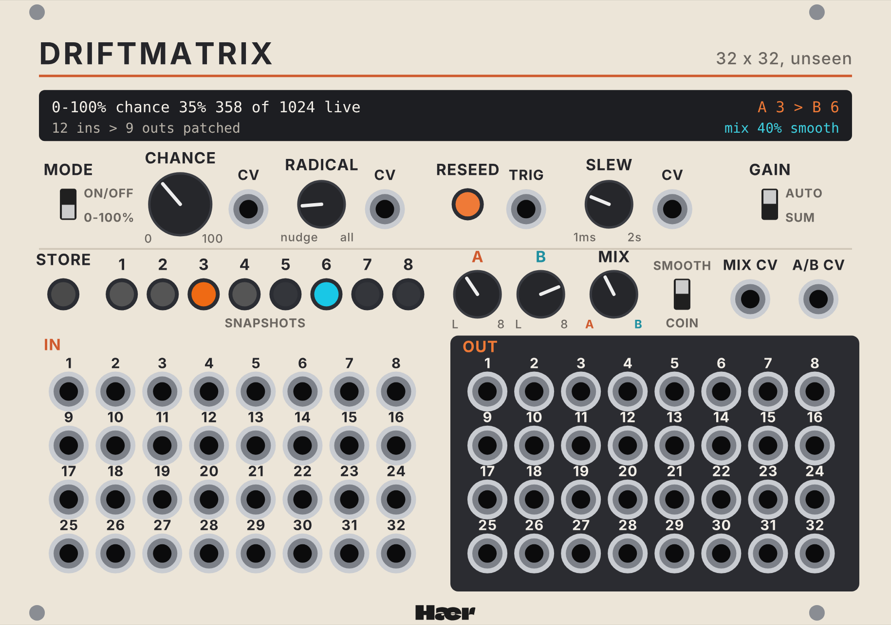

# DriftMatrix

A 32 x 32 matrix mixer for VCV Rack whose matrix you never see. Instead of
1024 little knobs you steer the randomness: how many crosspoints are active,
whether they're on/off or at random levels, how much a reseed changes, and
which two stored matrices you're mixing between.

## Controls

| Control | What it does |
|---|---|
| MODE | ON/OFF: every active crosspoint is full level. 0-100%: each active crosspoint has its own random level. |
| CHANCE (+CV) | How likely each crosspoint is to be active. Turning it up adds crosspoints one at a time; turning it down takes the same ones away again. +1 V = +10 %. |
| RADICAL (+CV) | How much RESEED changes. All the way up = a brand-new matrix. Low = only a few crosspoints get new dice, so the routing mutates slowly. |
| RESEED / TRIG | Rolls new dice (as much as RADICAL says). |
| SLEW (+CV) | How long every change takes, 1 ms to 2 s. Keeps audio click-free; long settings make CV routings glide. |
| GAIN | AUTO keeps each output no louder than one full-level input, however many inputs land on it. SUM just adds them (use the right-click soft clip if it gets hot). |
| STORE + slot | Tap STORE (it blinks), then tap a slot to save the LIVE matrix there. |
| Slot on its own | Loads that snapshot back into LIVE, so you can reseed from it with a low RADICAL. |
| A, B | Pick two matrices: L (the LIVE one) or slots 1-8. The A slot lights orange, B lights cyan, stored slots glow dim. |
| MIX (+CV) | Fades from A to B. |
| SMOOTH / COIN | SMOOTH crossfades every level. COIN makes each crosspoint jump from A to B at its own point as MIX turns, so the routing changes piece by piece. |
| A/B CV | Moves both A and B one place along (L, 1 ... 8, then round again) per volt. Feed it a stepped CV to walk through your snapshots. |

Snapshots remember the matrix's dice, so CHANCE and MODE still shape them live.
Only patched inputs count, and unpatched outputs cost no CPU.

Right-click: soft-clip outputs, fill every empty slot with a fresh random
matrix, clear all snapshots.

## Building

Every push builds a Mac (Apple Silicon) plugin on GitHub Actions; see the
"latest" release. The panel is drawn by `python3 res/make_panel.py`, and
`python3 tools/preview.py out.png` draws a picture with the controls in place.

## Licence

MIT (see `LICENSE.txt`): you're free to use, change, port (VST/CLAP, other platforms, hardware) and share this code, as long as the copyright notice and licence text come along. Fonts on the panel (Inter, Climate Crisis) are under the SIL Open Font Licence.
